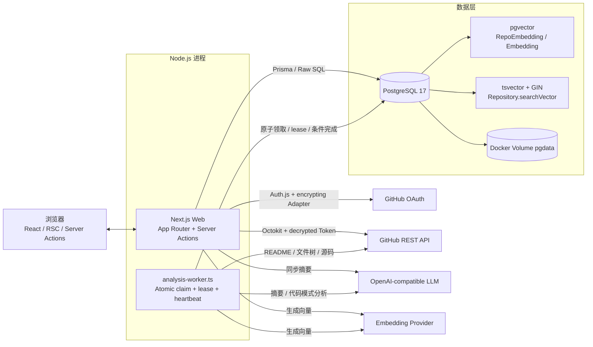
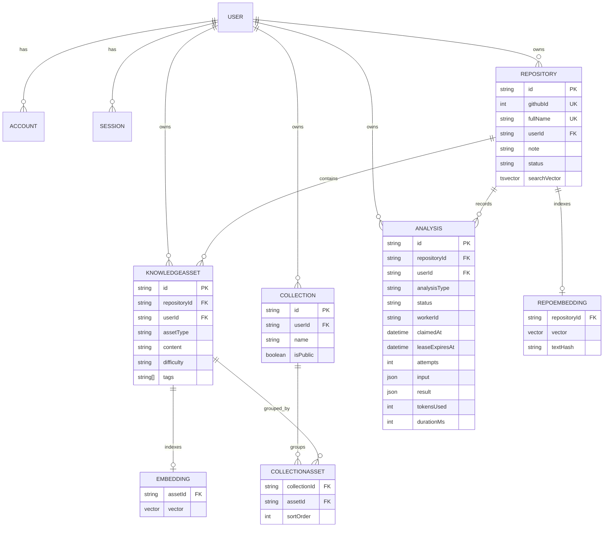

# GitHub Knowledge Hub 架构说明

> 架构基线：2026-11-04 当前源码。
> 本文描述代码结构；具体环境验证状态见 [PROJECT_MAINTENANCE_GUIDE.md](./PROJECT_MAINTENANCE_GUIDE.md)。

## 1. 架构风格

系统是个人知识管理全栈应用：

- **Next.js 单体 Web**：页面、RSC、Server Actions、Auth.js、业务服务和搜索。
- **独立 Worker**：消费 PostgreSQL `Analysis` 中的后台任务，通过 lease 协调多实例。
- **PostgreSQL**：业务数据、分析历史、任务状态、全文检索和向量数据。
- **外部服务**：GitHub OAuth/REST、OpenAI-compatible LLM、Embedding provider。

没有独立业务 API 服务、Redis、消息队列、对象存储或微服务网关。

## 2. 系统架构图



## 3. Web 与 Worker 职责边界

| 职责 | Next.js Web | Worker |
|---|---:|---:|
| 页面、登录、Session | 是 | 否 |
| GitHub 仓库同步 | 是 | 否 |
| 笔记、状态、收藏集 | 是 | 否 |
| 仓库归属和用户权限检查 | 是 | 依赖任务中的 userId/repositoryId |
| 单个/批量仓库摘要 | 当前主要同步执行 | 支持已入队的摘要 |
| 知识资产提取入队 | 是 | 否 |
| 知识资产提取执行 | 否 | 是 |
| README/源码读取 | 摘要时读取 README | 摘要和资产提取时读取 |
| Embedding | 摘要后尽力触发 | 摘要/资产任务中尽力触发 |
| Discover/资产搜索 | 是 | 否 |
| Analysis 状态写入 | 同步任务直接写入 | 领取、执行、完成/失败 |

### 运行要求

- 只使用页面、同步、笔记和同步摘要时，可以只运行 Web。
- 使用知识资产提取时，必须额外运行 `npm run worker`。
- 桌面快捷方式默认同时启动 Web 和 Worker，并分别维护 PID 与日志；重复启动复用现有实例。
- 多实例通过 PostgreSQL `FOR UPDATE SKIP LOCKED`、lease 和条件写入协调；部署 leasing migration 前必须停止旧 Worker。当前仍没有生产级 supervisor 或自动健康修复。

## 4. 主要数据流

### 4.1 GitHub 同步

1. Auth.js 完成 GitHub OAuth；加密 Prisma Adapter 在 `linkAccount` 时加密 access/refresh Token，再保存 User/Account/Session。
2. Server Action 从当前用户 Account 读取并解密 OAuth Token，创建带 retry/throttling 的 Octokit。旧明文兼容；错误 key/损坏密文显式失败。
3. 同步我的仓库或 Starred 仓库到 Repository。
4. Library 读取当前用户数据，补充最新摘要和 Embedding 新鲜度。

`TOKEN_ENCRYPTION_KEY` 是 base64 32-byte 当前 key；`TOKEN_ENCRYPTION_KEY_PREV` 只用于轮换期间解密旧密文。新写入缺 key 时拒绝落库，真实存量 Token 需要单独运行幂等 migration 脚本。

### 4.2 仓库摘要

1. 校验 Session 和 Repository 归属。
2. 查询最新 completed `repo_summary`，命中则返回缓存。
3. 获取 README，创建 running Analysis。
4. 调用主 LLM，保存结构化结果或错误。
5. 成功后异步、尽力生成 RepoEmbedding；Embedding 失败不抹掉摘要。

### 4.3 资产提取

1. Web 创建 pending `asset_extraction`。
2. Worker 以单条 `UPDATE ... SELECT ... FOR UPDATE SKIP LOCKED ... RETURNING` 原子领取，写入 `workerId`、`claimedAt`、`leaseExpiresAt` 并增加 attempts。
3. 执行期间每 20 秒续租；60 秒 lease 过期后其他 Worker 可恢复任务，达到 3 次 attempts 后 terminal failed。
4. 获取 GitHub 文件树，筛选支持的源码文件，默认最多 20 个；读取内容，按路径去重，可使用 LLM 提取代码模式。
5. 创建 KnowledgeAsset，尽力生成 Embedding；`(repositoryId, sourcePath)` 唯一约束配合 P2002 处理防止并发重复资产。
6. complete/fail/renew 同时校验 id、workerId、running 状态和有效 lease，stale worker 不得覆盖新 Worker 的结果。

### 4.4 搜索

- **semantic**：查询文本生成向量，使用 pgvector cosine distance。
- **keyword**：使用 `searchVector @@ websearch_to_tsquery` 和 `ts_rank`。
- **hybrid**：`(1 - cosineDistance) * 0.7 + ts_rank * 0.3` 加权排序。
- **相似推荐**：以现有 RepoEmbedding/Embedding 为目标向量查找邻居。
- 所有查询都必须按 userId 隔离。

keyword/hybrid 依赖 generated column 和 GIN。真实 Docker 数据库已完成 migration；三模式及用户隔离行为已在隔离 PostgreSQL 中验证，真实 semantic/hybrid 仍取决于有效 RepoEmbedding 和 Embedding provider。

## 5. 数据库实体关系



### 关键设计约束

- Repository、KnowledgeAsset、Collection、Analysis 都有用户维度。
- Repository 的 `githubId` 和 `fullName` 是全局唯一，而不仅是用户内唯一；多人保存同一 GitHub 仓库时需重新评估该约束。
- Analysis.repositoryId 可空，删除 Repository 时设为 null，用户删除时级联删除 Analysis。
- KnowledgeAsset 与 Collection 通过 CollectionAsset 多对多关联。
- 两个 Embedding 表均为 1536 维，模型/维度变更需要 schema migration。
- `Repository.searchVector` 是由 name、description、topics 派生的 stored generated `tsvector`；GIN 名为 `Repository_searchVector_idx`。
- PostgreSQL 将通用 `array_to_string` 标为 stable，因此 migration 提供仅限 `text[]` 的 immutable SQL wrapper `gkh_text_array_to_string`。Prisma schema 用 `@default(dbgenerated())` 和 `@@index(..., type: Gin)` 声明原生对象，表达式本体仍由 SQL migration 管理。
- `Analysis` 同时是历史和队列；Worker 以 `FOR UPDATE SKIP LOCKED` 原子领取，并写入 `workerId`、`claimedAt`、`leaseExpiresAt`、`attempts`。60 秒 lease、20 秒 heartbeat、最多 3 次 attempts，complete/fail/renew 均校验 worker ownership 和有效 lease。
- `KnowledgeAsset(repositoryId, sourcePath)` 有数据库唯一约束；并发创建发生冲突时提取服务处理 P2002，避免重复知识资产。

## 6. 代码分层

```text
src/app/                 App Router 页面、布局和 Auth API
src/actions/             带 Session 检查的 Server Actions
src/services/github/     GitHub 仓库、README、文件树和内容
src/services/llm/        摘要、Embedding、搜索和分析历史
src/services/knowledge/  代码资产提取
src/services/intake/     Analysis 入队
src/lib/                 Prisma/OpenAI 客户端、加密 Adapter、GitHub Token、工具
src/services/analysis/   Worker 原子领取、lease、heartbeat 与条件写入
workers/                 独立后台进程
prisma/migrations/       init、原生搜索对象、Worker leasing 三条 migration
scripts/                 桌面启动/停止、migration、Token 迁移与隔离测试工具
tests/                   单元测试与隔离 PostgreSQL 集成测试
.github/workflows/       GitHub Actions 静态检查/build 与集成测试
docs/                    维护、架构与路线图
```

## 7. 部署边界

- Docker Compose 只包含 PostgreSQL + pgvector 和持久化 Volume。
- Web 与 Worker 运行在 Node.js 主机，可分别扩缩和排查。
- GitHub Actions 在 Ubuntu 上分为静态检查/build 与 Docker PostgreSQL/pgvector 集成测试两个 jobs；CI 只使用 dummy secrets，临时容器/Volume 的清权限于 CI。
- 当前没有应用 Dockerfile、生产 Compose、反向代理或生产级进程守护配置。
- WSL 和 Docker 是两套数据库部署方式，数据卷不共享。
- 生产环境应使用外部备份、版本化 migration、HTTPS、独立 Web/Worker 进程管理和秘密管理。

### Migration 与本地进程边界

- 新环境由 `npm run db:deploy` 应用版本化 migrations；旧 `db push` 环境只能在备份恢复验证和 schema 检查后显式 baseline。
- 桌面启动只读取 migration 状态，不修改 schema；结构升级是独立维护动作，不与 Web/Worker 生命周期耦合。应用 leasing migration 前必须停止旧 Worker，升级后再启动新 Web/Worker。
- `scripts/start-desktop.ps1` 以 PID + StartTime 管理 Web/Worker，日志写入 `logs/`，停止脚本只处理匹配的本项目进程。
- 这是本地开发进程管理，不是带自动重启、健康修复和生产保活能力的 supervisor。

## 8. 架构演进顺序

1. 版本控制、migration、全文搜索和核心 smoke test 已于 2026-11-03 完成。
2. Token 新写入加密、Worker 原子领取/leasing、业务回归和 CI 配置已于 2026-11-04 完成；真实存量 Token 迁移与外部服务验收仍有独立边界。
3. 下一阶段统一摘要执行链、持久化 difficulty、采集 tokensUsed/durationMs，再按需求完善收藏集。
4. 只有在真实负载证明需要时，才考虑 Redis 队列、对象存储或独立 API；不要提前引入微服务。
