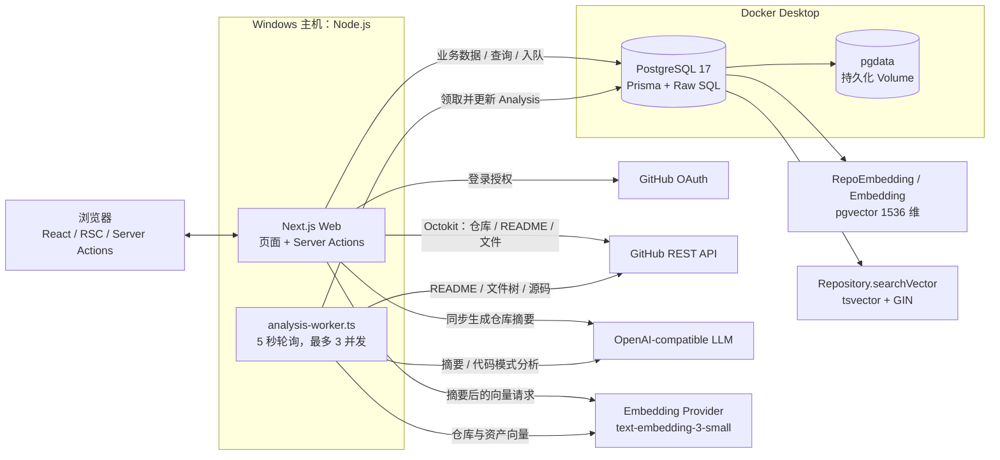
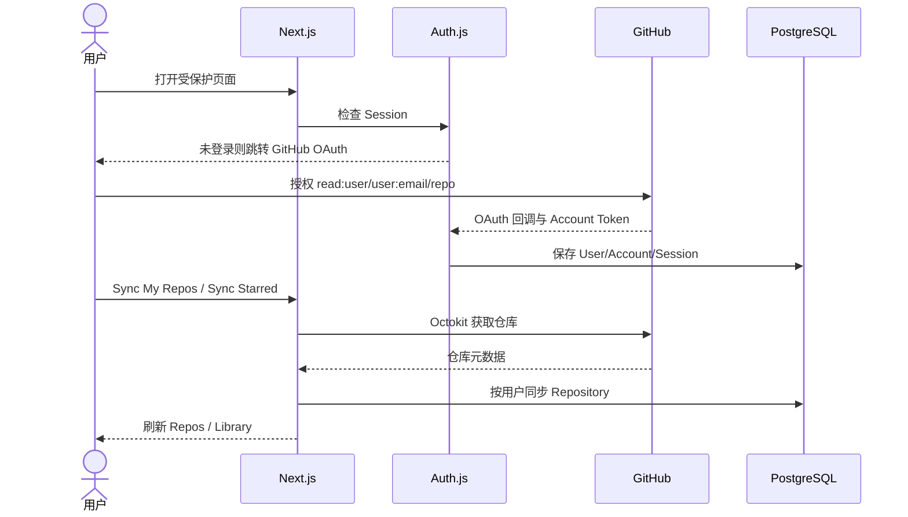
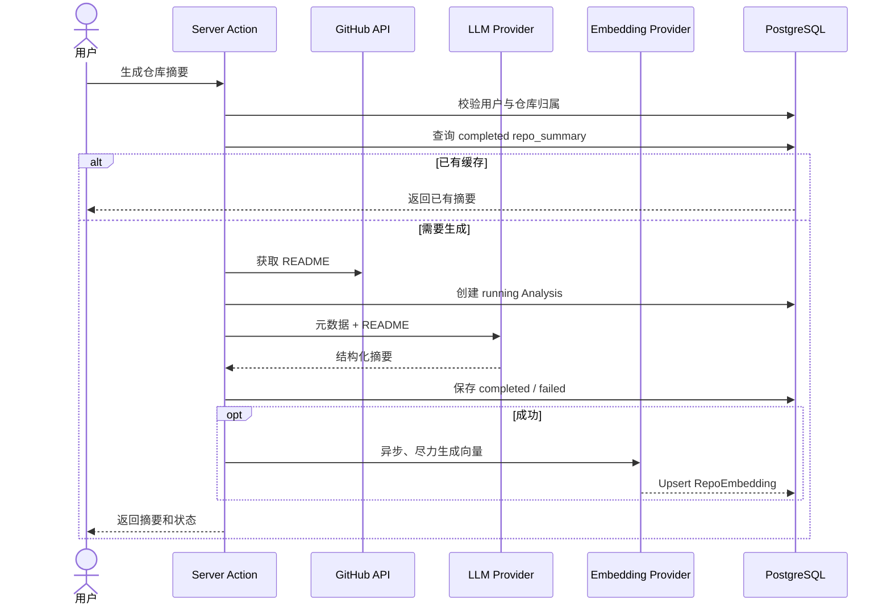
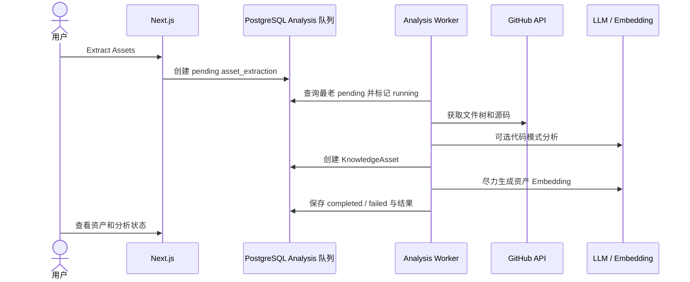

# GitHub Knowledge Hub 项目维护指南

> 整理日期：2026-11-03  
> 依据：当前源码、隔离测试、真实备份恢复演练、真实 migration 与本地启动验证。
> 本文用于长期维护，不代表所有功能均已在整理当日重新完成端到端验收。

## 1. 项目定位

GitHub Knowledge Hub 是一个个人 GitHub 知识管理工作台，核心链路为：

**GitHub 仓库同步 → 个人笔记与状态管理 → LLM 仓库摘要与代码资产提取 → PostgreSQL 向量/全文检索 → 相似推荐与收藏整理。**

系统采用 **Next.js 单体 Web + 独立 TypeScript Worker + PostgreSQL/pgvector**，不是微服务架构。没有独立业务后端、Redis、BullMQ 或对象存储；业务页面和服务端逻辑主要由 Next.js 承担，`Analysis` 表同时保存分析历史和后台任务。

## 2. 验证口径

### 2.1 源码已实现

“源码已实现”表示页面、Server Action、服务或 Worker 调用链在代码中存在并相互连接，不等于当前环境已完成真实外部服务验收。

### 2.2 P0 修复后的实际验证（2026-11-03）

**真实数据库备份与迁移**

- 真实库审计：PostgreSQL 17.11、pgvector 0.8.7、11 张业务表、219 个 Repository；迁移前 `searchVector` 全为 NULL、无视图等依赖，表约 120 kB。
- 完整 custom-format 备份：`db-backups/gkh-p0-20261103-230915.dump`，68,203 bytes，SHA-256 `21f7f6efb686386cfe563f93e09a4ea344812685e6fa41b3098fd2973ba0e8f4`。`pg_restore --list` 和隔离恢复成功；11 张表记录数、内容哈希及结构指纹全部一致。
- 在另一份真实备份恢复库完成 baseline + 增量 migration；排除派生 `searchVector` 后，11 张表内容哈希不变，其他列、索引、约束、扩展和函数指纹不变。自动更新测试在事务内通过后回滚。
- **真实 Docker 数据库随后已执行相同 migration**，两条记录均成功；迁移前后业务内容哈希不变。真实只读检查确认 generated stored column、GIN、0 个 NULL searchVector、keyword 命中及空 Prisma drift，`prisma migrate status` 为 up to date。

**隔离自动化与静态验证**

- `npm test`：2 个文件、8 个单元测试通过，覆盖 Worker 状态分支、异常释放和启动脚本安全约束；GitHub/LLM 均 Mock。
- `npm run test:integration`：3 个文件、13 个测试通过。覆盖空库 `migrate deploy`、旧 `db push` 库 baseline、数据保留、1536 维向量、generated/GIN、migration 后空 Prisma diff、keyword/semantic/hybrid、筛选、用户隔离、空结果、异常输入、自动维护和真实 Web+Worker 启动/停止。
- 集成测试只创建并清理唯一 `gkh_test_*` 数据库；semantic/hybrid 使用确定性 1536 维向量和 Mock provider，没有调用付费 API。
- `npm run typecheck`、`npx prisma validate`、`npm run build` 通过；生产构建生成 11 个静态页面。
- `npm run lint` 无错误，保留原有 `analysis.service.ts:531` 的 1 个未使用参数 warning。

**真实桌面进程**

- `scripts/start-desktop.ps1` 在真实 migration 状态下启动 Web 和 Worker；`http://localhost:3000` 返回 HTTP 200。
- 第二次启动保留相同 Web/Worker PID，没有重复实例；Worker 显示 started，Web/Worker 错误日志均为空。两个 Analysis 均为 completed，启动时未领取真实任务。

### 2.3 尚未完成的真实端到端验证

- GitHub OAuth 完整登录回调。
- 我的仓库/Starred 仓库真实同步。
- OpenAI/DeepSeek 真实 LLM 请求。
- Embedding 真实生成与语义搜索。
- 知识资产提取 Worker 的完整任务链。
- 收藏集和笔记的人工浏览器回归。

旧文档记录 2026-05-27 OAuth E2E 曾通过，但不能替代当前环境的重新验收。

## 3. 功能清单

### 3.1 已接通的源码功能

| 模块 | 实现内容 | 关键入口 |
|---|---|---|
| GitHub 登录 | Auth.js + Prisma Adapter；scope 为 `read:user user:email repo`；未登录跳转 | `src/auth.ts`、`src/middleware.ts` |
| Dashboard | 仓库、摘要、资产、分析、收藏统计；资产分布、最近分析、热门标签、缺失资产提示 | `src/app/(dashboard)/page.tsx` |
| 仓库同步 | 同步我的仓库与 Starred 仓库；保存语言、Star、Fork、Topic、默认分支等 | `src/actions/repos.ts` |
| Library | 搜索名称/描述/笔记/摘要；按状态、摘要、语言、Topic 筛选；多种排序 | `src/app/(dashboard)/library/library-client.tsx` |
| 个人管理 | 编辑笔记，维护 `new/analyzing/active/archived` 状态，查看详情 | `src/actions/repos.ts` |
| AI 仓库摘要 | 基于元数据和 README 输出一句话、问题、技术栈、场景、亮点、学习价值、复用建议等 | `src/services/llm/analysis.service.ts` |
| 摘要缓存/重试 | 已完成结果复用，失败重试，成功后尽力生成 RepoEmbedding | `src/services/llm/analysis.service.ts` |
| 批量摘要 | 对筛选结果中缺少摘要的仓库顺序执行，显示进度、停止和失败统计 | `library-client.tsx` |
| 代码资产提取 | 读取 GitHub 文件树和源码，默认最多 20 个文件；识别类型、Tag，可使用 LLM 分析代码模式 | `src/services/knowledge/extraction.service.ts` |
| 资产库 | 资产列表、详情、源码、摘要、来源；向量搜索、条件筛选、相似资产 | `src/actions/knowledge.ts`、`src/services/llm/embeddings.service.ts` |
| Discover | `hybrid/semantic/keyword` 三模式；语言、最低 Star、Topic 筛选；相似仓库 | `src/services/llm/repo-embedding.service.ts` |
| Collections | 创建/删除收藏集，添加/移除知识资产，查看收藏详情 | `src/actions/collections.ts` |
| Analyses | 最近 50 条分析，按类型和状态筛选，显示模型与错误 | `src/services/llm/analysis.service.ts` |
| Worker | 5 秒轮询，单进程最多 3 并发；处理 `repo_summary` 和 `asset_extraction` | `workers/analysis-worker.ts` |
| 中英文/主题 | Cookie 保存中英文偏好；next-themes 支持系统主题 | `src/i18n/`、`src/components/providers.tsx` |

### 3.2 两条 AI 执行链

1. **仓库摘要按钮和批量摘要**：调用 `analyzeRepositoryAction()`，在 Next.js Server Action 中同步执行，不依赖 Worker。
2. **知识资产提取**：调用 `extractAssetsAction()` 创建 `pending Analysis`，必须运行 Worker 才会完成。

`src/actions/intake.ts` 还包含摘要入队和批量入队接口，但整理时未发现页面引用，不应将其描述为已接通的 UI 队列功能。

### 3.3 部分实现

- **难度筛选**：LLM 返回 difficulty，但资产创建时未持久化，筛选缺少有效数据。
- **分析遥测**：`tokensUsed`、`durationMs` 有数据库字段和 UI，但未采集真实值。
- **收藏集分享**：`Collection.isPublic` 已设计，但没有公开页面和完整分享链。
- **Embedding 可用性**：生成失败不会阻止摘要/资产保存，因此可能出现“有摘要、无索引”，UI 会提示。
- **摘要队列**：Worker 支持，但当前 UI 主要走同步摘要路径。

### 3.4 未实现或不应误判为已完成

- `analyzeDependencies()` 明确抛出未实现异常。
- 收藏集重命名、描述编辑和公开分享未完整实现。
- GitHub Code Search、按 Topic 搜索 GitHub 的服务函数没有独立用户页面。
- 没有通用业务 REST API；业务交互主要使用 Server Actions。
- 没有生产级多 Worker 调度、公开多租户分享或完整 CI/CD。

## 4. 核心技术栈

以下为整理时实际安装的核心版本；`package.json` 中的语义化范围可能允许后续安装不同次版本。

| 层次 | 技术与版本 | 职责 |
|---|---|---|
| Web | Next.js 15.5.18、React 19.2.6 | App Router、RSC、Server Actions |
| 语言 | TypeScript 5.9.3，strict | 类型检查，`@/*` 路径别名 |
| 登录 | Auth.js 5.0.0-beta.31、Prisma Adapter | GitHub OAuth、Session/Account |
| GitHub | Octokit 21.1.1、retry/throttling | 仓库、README、文件树和源码 |
| LLM | OpenAI SDK 4.104.0 | OpenAI-compatible Chat Completions |
| 数据库 | PostgreSQL 17、Prisma 6.19.3 | 业务数据、分析记录和任务 |
| 搜索 | pgvector、tsvector、GIN | 向量、全文及混合检索 |
| UI | Tailwind 4.3、shadcn/ui、Radix/Base UI | 页面与组件系统 |
| UI 辅助 | Lucide、next-themes、sonner、react-markdown、SWR | 图标、主题、通知、Markdown、数据请求 |
| Worker | tsx 4.22.3 | 直接运行 TypeScript Worker |
| 进程编排 | concurrently 9.2.1、PowerShell | `dev:all` 前台运行；桌面 PID/日志管理 |
| 测试 | Vitest 3.2.4 | 单元测试与隔离 PostgreSQL 集成测试 |

Embedding 模型和维度当前硬编码为 `text-embedding-3-small`、1536 维。更换不同维度模型必须同步修改服务和数据库 vector 类型。

## 5. 系统架构



详细职责和实体关系见 [ARCHITECTURE.md](./ARCHITECTURE.md)。

## 6. 核心业务调用链

### 6.1 登录与仓库同步



### 6.2 同步仓库摘要



### 6.3 知识资产提取



## 7. 数据模型

核心关系：

```text
User
 ├─ Account / Session
 ├─ Repository
 │   ├─ Analysis
 │   ├─ RepoEmbedding（一对一）
 │   └─ KnowledgeAsset
 │       ├─ Embedding（一对一）
 │       └─ CollectionAsset
 ├─ Collection
 │   └─ CollectionAsset
 └─ Analysis
```

- `Repository`：GitHub 元数据、个人笔记和状态；`searchVector` 用于全文搜索。
- `KnowledgeAsset`：源码、摘要、类型、Tag、语言、难度和来源。
- `Analysis`：类型、状态、输入、结果、错误、模型、Token 和耗时；同时充当 Worker 队列。
- `RepoEmbedding`：保存仓库向量及 `textHash`，用于新鲜度判断。
- `CollectionAsset`：Collection 与 KnowledgeAsset 的多对多连接表。

schema 入口：`prisma/schema.prisma`。migration 入口：`prisma/migrations/20261103230000_init/` 与 `20261103231000_repository_search_vector/`。`searchVector` 在 Prisma 中声明为 `@default(dbgenerated())` 和 GIN index，实际 generated 表达式由 SQL migration 管理。

## 8. Windows + Docker 本地部署

### 8.1 架构边界

Docker Compose 只运行 PostgreSQL；Next.js 和 Worker 直接运行在 Windows Node.js 主机。Docker Volume `pgdata` 持久化数据库。

### 8.2 数据库初始化、baseline 与手动启动

**全新数据库：**

```bash
cd F:\Claude\ClaudeCodeProject\GithubKnowledgeHub
docker compose up -d
npm run db:deploy
npm run dev:all
```

`db:deploy` 应用完整初始 migration 和 searchVector 增量 migration，并检查 generated/GIN/migration 历史。新环境不需要 `db push`。

**既有 `db push` 数据库：** 必须先备份、隔离恢复并审查差异。以下命令不得对未核实的非空库直接执行：

```bash
npm run db:baseline       # dry-run；不写 migration 历史
npm run db:baseline:apply # 显式应用 baseline + 增量 migration
```

baseline 脚本会拒绝：已有 `_prisma_migrations`、非普通 `searchVector`、既有 search GIN、或除待建 GIN 外的 Prisma schema 差异。只有检查通过才会 `migrate resolve --applied 20261103230000_init`，随后 `migrate deploy`。若增量阶段失败，修复后使用 `npm run db:deploy`，不要重复 baseline。

**当前真实 Docker 数据库已完成此过程，后续只需：**

```bash
npm run db:deploy
npx prisma migrate status
npm run dev:all
```

也可分别运行 `npm run dev` 和 `npm run worker`。日常启动不属于 schema 维护操作，禁止重新加入 `db push` 或自动 `migrate deploy`。

### 8.3 桌面快捷方式

桌面 `GitHub Knowledge Hub.lnk` 指向：

```text
powershell.exe -NoLogo -NoExit -ExecutionPolicy Bypass -File "F:\Claude\ClaudeCodeProject\GithubKnowledgeHub\scripts\start-desktop.ps1"
```

脚本职责：

1. 用启动互斥锁、PID + 进程 StartTime 记录避免重复 Web/Worker；PID 重用不会被当作同一进程。
2. 检查并按安装路径启动 Docker Desktop，启动 Compose PostgreSQL，等待 `pg_isready`。
3. 只执行 `prisma validate` 和只读 `prisma migrate status`；不创建扩展、不 `db push`、不自动 deploy。
4. 后台启动 Worker 和 Next.js，检查 Worker 早期退出并等待 Web HTTP 可用。
5. 分别写入 `.run/web.json`、`.run/worker.json` 与 `logs/web*.log`、`logs/worker*.log`；页面可用后打开浏览器。

管理命令：

```bash
npm run dev:desktop
npm run dev:desktop:stop
```

停止脚本只停止 PID/StartTime 均匹配的本项目进程，不停止 PostgreSQL 或无关进程。启动失败时查看 `logs/web.error.log` 和 `logs/worker.error.log`。`asset_extraction` 依赖 Worker；桌面路线默认已同时启动两者。

### 8.4 WSL 旧路线

`npm run dev:local` 调用 `scripts/start-dev.ps1`，依赖 WSL PostgreSQL。整理时当前机器没有可用 WSL Linux 发行版，因此使用 Docker 路线。

WSL PostgreSQL 与 Docker Volume 是不同数据存储，切换时不会自动迁移数据。

## 9. 环境变量

只记录名称和用途，真实值不得进入版本控制。

| 变量 | 用途 |
|---|---|
| `DATABASE_URL` | Prisma PostgreSQL 连接串 |
| `AUTH_SECRET` | Auth.js 密钥，也被现有 Token 加解密工具引用 |
| `AUTH_GITHUB_ID` | GitHub OAuth Client ID |
| `AUTH_GITHUB_SECRET` | GitHub OAuth Client Secret |
| `AUTH_URL` | 部署环境的 Auth.js 外部 URL |
| `OPENAI_API_KEY` | 主 LLM API Key |
| `OPENAI_BASE_URL` | OpenAI-compatible Base URL |
| `OPENAI_MODEL` | 主 LLM 模型；代码默认 `gpt-4o-mini` |
| `EMBEDDING_API_KEY` | 独立 Embedding Key；未配置时回退主 Key |
| `EMBEDDING_BASE_URL` | 独立 Embedding Base URL；未配置时回退主 Base URL |

注意：

- 主 LLM 使用 DeepSeek 时，应为 Embedding 单独配置兼容 provider。
- `.env.example` 中的 `EMBEDDING_MODEL` 当前不控制实际模型，模型在代码中硬编码。
- 文档中的 `GITHUB_TOKEN` 在整理时未被业务源码读取，实际使用用户 OAuth Account Token。
- `.env`、`.env.local`、`.env.production` 等真实配置必须保持本地，不得提交。

## 10. 已知问题与技术债

### P0：已完成（2026-11-03）

1. **Git 与备份**：Private GitHub 仓库和普通推送已建立；数据库 custom-format 备份、隔离恢复及逐表哈希验证完成。
2. **全文搜索**：真实库和隔离库均为 generated stored `searchVector` + GIN；name/description/topics 自动维护已验证。
3. **migration 管理**：完整初始基线和增量 migration 已版本化；真实旧库经备份副本演练后 baseline。`@default(dbgenerated())` 与 Prisma GIN 声明消除了已发现的 generated/GIN drift。
4. **启动与 smoke test**：桌面默认 Web+Worker、无 schema 写入；8 个单元测试和 13 个隔离集成测试通过。

旧 `hybrid-search.sql` 已删除。它使用 `ADD COLUMN IF NOT EXISTS`，无法转换既有普通列；其 `array_to_string()` 也不是 PostgreSQL 接受的 immutable generated expression。现 migration 使用仅限 `text[]` 的确定性 SQL wrapper `gkh_text_array_to_string`，并以隔离测试验证 topics 搜索。不得恢复旧手工 SQL 作为日常修复手段。

### P1：上线与长期维护前处理

1. GitHub OAuth Token 写入加密链未接通，`encryptToken()` 未发现调用方，解密兼容明文。
2. Worker 的“原子领取”实际为先 `findFirst` 再 `update`，多实例可能重复处理。
3. 已有本地单元/集成测试，仍缺少 GitHub Actions CI。
4. README、`.env.example`、源码 TODO 和 Phase 状态存在漂移。
5. 没有应用 Dockerfile、生产 Compose、反向代理和进程守护配置。

### P2：功能完整性

1. difficulty 真正持久化并回填。
2. 采集真实 `tokensUsed` / `durationMs`。
3. 收藏集编辑、公开分享及权限模型。
4. 统一摘要同步与队列执行链，明确缓存、幂等和重试语义。

详细方案与验收标准见 [DEVELOPMENT_ROADMAP.md](./DEVELOPMENT_ROADMAP.md)。

## 11. 后续开发代码导航

| 修改目标 | 优先入口 |
|---|---|
| 页面与交互 | `src/app/(dashboard)/` |
| Server Actions | `src/actions/` |
| GitHub 集成 | `src/services/github/`、`src/lib/github/` |
| 摘要、Embedding、搜索 | `src/services/llm/` |
| 代码资产提取 | `src/services/knowledge/` |
| 后台任务 | `workers/analysis-worker.ts` |
| 数据模型 | `prisma/schema.prisma` |
| 全文搜索 migration | `prisma/migrations/20261103231000_repository_search_vector/migration.sql` |
| 本地启动 | `package.json`、`scripts/start-desktop.ps1` |
| 中英文 | `src/i18n/` |

## 12. 故障排查

### 12.1 页面无法访问

```bash
docker compose ps
docker ps
npm run dev
```

检查 3000 端口是否被其他进程占用。桌面脚本不会自动杀死已有进程。

### 12.2 数据库未就绪

```bash
docker logs github-knowledge-hub-db
docker exec github-knowledge-hub-db pg_isready -U postgres -d github_knowledge_hub
```

不要为排障直接执行 `docker compose down -v` 或删除 Volume。

### 12.3 资产提取一直 pending

确认 Worker 已启动：

```bash
npm run worker
```

检查 `Analysis.status`、`Analysis.error` 和 Worker 控制台。生产多 Worker 前必须先修复原子任务领取。

### 12.4 摘要有结果但语义搜索为空

- 检查 `RepoEmbedding` 是否存在。
- 检查独立 Embedding 配置及 provider 是否支持 `text-embedding-3-small`。
- 检查 UI 的 not indexed / stale 提示。
- 可使用现有 `scripts/backfill-embeddings.ts`，但先在测试环境验证，且真实运行会调用付费 API 并写数据库。

### 12.5 keyword / hybrid 搜索异常

优先检查 `Repository.searchVector` 是否为 generated column、GIN 索引是否存在、数据是否自动填充。不要只重跑带 `IF NOT EXISTS` 的 SQL 后就认定修复。

### 12.6 Prisma 报 DATABASE_URL 缺失

从项目根目录执行 Prisma，使 `.env` 被发现：

```bash
cd F:\Claude\ClaudeCodeProject\GithubKnowledgeHub
npx prisma validate
```

不要把真实 `DATABASE_URL` 放进命令行、文档或 Git。

## 13. 备份与隔离恢复

以下 PowerShell 示例把 custom-format dump 先写入容器，再用 `docker cp` 取回，避免 Windows PowerShell 文本重定向破坏二进制备份。备份包含 Account Token 等敏感内容，只能保存在受保护的本地目录；`db-backups/` 已被 Git 忽略。

```powershell
New-Item -ItemType Directory -Force db-backups | Out-Null
$stamp = Get-Date -Format "yyyyMMddHHmmss"
$dumpName = "gkh-$stamp.dump"
docker exec github-knowledge-hub-db pg_dump -U postgres -d github_knowledge_hub --format=custom --encoding=UTF8 --file="/tmp/$dumpName"
if ($LASTEXITCODE -ne 0) { throw "pg_dump failed" }
docker cp "github-knowledge-hub-db:/tmp/$dumpName" ".\db-backups\$dumpName"
docker exec github-knowledge-hub-db pg_restore --list "/tmp/$dumpName"
if ($LASTEXITCODE -ne 0) { throw "Backup TOC validation failed" }
```

恢复到**唯一隔离数据库**，不要覆盖真实库，不使用 `--clean`：

```powershell
$restoreDb = "gkh_restore_$stamp"
docker exec github-knowledge-hub-db createdb -U postgres $restoreDb
docker exec github-knowledge-hub-db pg_restore -U postgres -d $restoreDb --exit-on-error --single-transaction "/tmp/$dumpName"
if ($LASTEXITCODE -ne 0) { throw "Isolated restore failed" }
```

恢复成功仍不代表数据等价；必须继续比较所有业务表的记录数、内容哈希及列/索引/约束/扩展。migration 演练还应排除派生 `searchVector` 比较业务字段，并确认差异仅限预期对象。隔离库清理前逐一核对 `datname`，禁止删除 Volume 或对真实库执行 reset。

## 14. 维护建议

1. 先建立可恢复的 Git/数据库备份，再做 migration 和业务修改。
2. 数据库验证使用独立测试实例，不在个人真实数据上试验迁移。
3. 每次修改至少运行 TypeScript、Prisma validate、ESLint 和相关 smoke test。
4. 改动搜索时同时覆盖 keyword、semantic、hybrid 三模式及用户隔离。
5. 改动 Worker 时验证 pending/running/completed/failed、异常恢复和并发领取。
6. 定期同步 README、架构文档、环境变量模板和实际源码。
7. 真实 OAuth Secret、API Key、Access Token、数据库备份不得进入 Git。
