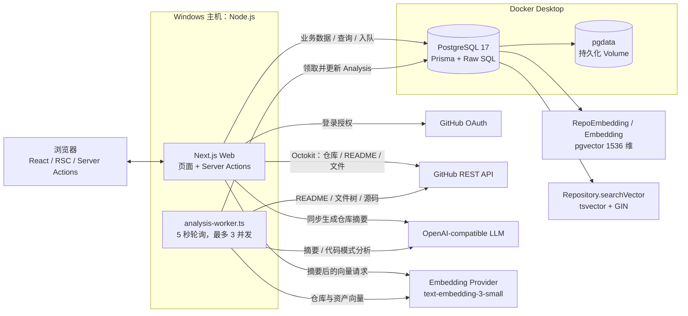
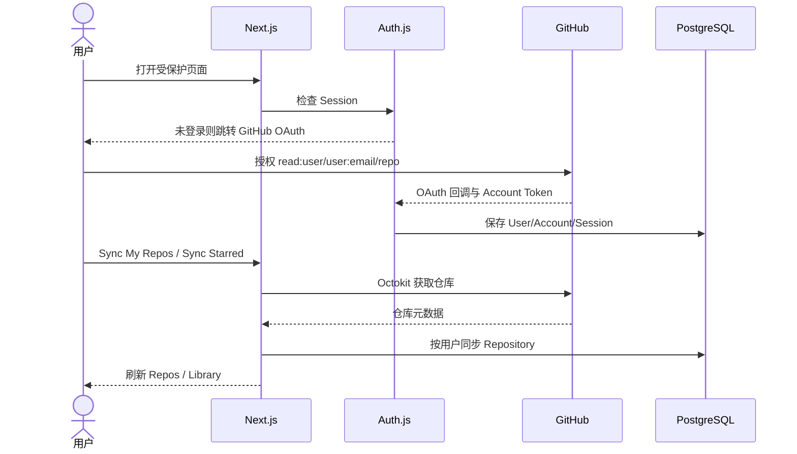
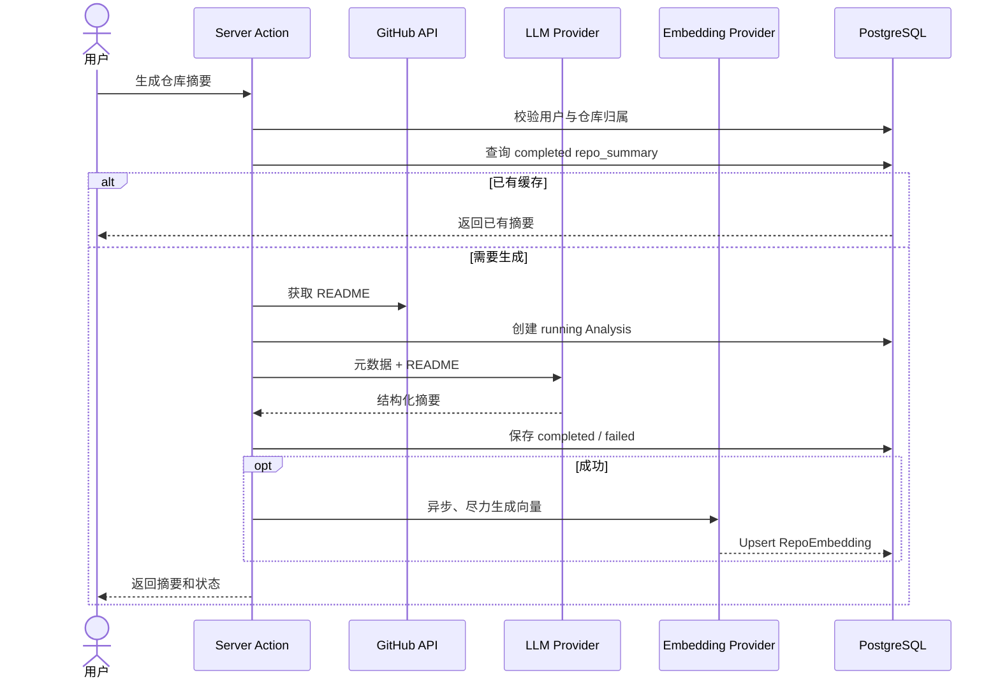
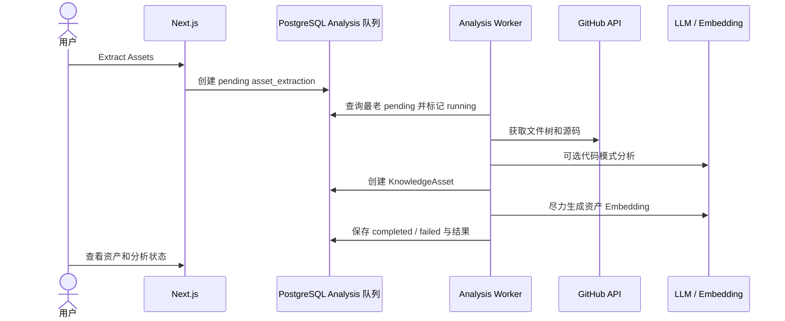

# GitHub Knowledge Hub 项目维护指南

> 整理日期：2026-11-03  
> 依据：当前工作区源码、配置、数据库只读检查及本地启动验证。  
> 本文用于长期维护，不代表所有功能均已在整理当日重新完成端到端验收。

## 1. 项目定位

GitHub Knowledge Hub 是一个个人 GitHub 知识管理工作台，核心链路为：

**GitHub 仓库同步 → 个人笔记与状态管理 → LLM 仓库摘要与代码资产提取 → PostgreSQL 向量/全文检索 → 相似推荐与收藏整理。**

系统采用 **Next.js 单体 Web + 独立 TypeScript Worker + PostgreSQL/pgvector**，不是微服务架构。没有独立业务后端、Redis、BullMQ 或对象存储；业务页面和服务端逻辑主要由 Next.js 承担，`Analysis` 表同时保存分析历史和后台任务。

## 2. 验证口径

### 2.1 源码已实现

“源码已实现”表示页面、Server Action、服务或 Worker 调用链在代码中存在并相互连接，不等于当前环境已完成真实外部服务验收。

### 2.2 整理当日实际验证

- Windows 桌面快捷方式成功启动 Docker Desktop、PostgreSQL 和 Next.js。
- `http://localhost:3000/` 返回 HTTP 200，并跳转 `/login?callbackUrl=%2F`。
- TypeScript `--noEmit` 类型检查通过。
- 在项目根目录执行 `prisma validate` 通过。
- `npm run lint` 通过；保留 `analysis.service.ts` 中 `_opts` 未使用的 1 条 warning，以及 `next lint` 将在 Next.js 16 移除的弃用提示。
- 使用 staged 文件、独立临时目录和非生产哑配置执行 `next build` 成功，完成编译、类型检查和 11 个静态页面生成；未读取真实 `.env`，未连接真实数据库。
- 6 个 staged Markdown 文件的 7 个相对链接目标均存在；2 个 flowchart、1 个 ER 图和 3 个 sequenceDiagram 共 6 个 Mermaid 块均通过 Mermaid 11 本地解析。
- 项目没有 `test` 脚本和已发现的业务自动化测试，因此没有可报告的测试通过数量。
- Docker PostgreSQL 容器运行，`5432` 端口映射正常，pgvector 扩展存在。
- 对当前 Docker 数据库进行了只读检查，发现全文搜索列和索引不符合手写迁移的设计，详见 P0 技术债。

### 2.3 整理当日未重新端到端验证

- GitHub OAuth 完整登录回调。
- 我的仓库/Starred 仓库真实同步。
- OpenAI/DeepSeek 真实 LLM 请求。
- Embedding 真实生成与语义搜索。
- 知识资产提取 Worker 的完整任务链。
- 收藏集和笔记的人工浏览器回归。

旧文档记录 2026-05-27 OAuth E2E 曾通过，但不能替代当前环境的重新验收。

## 3. 功能清单

### 3.1 已接通的源码功能

| 模块 | 实现内容 | 关键入口 |
|---|---|---|
| GitHub 登录 | Auth.js + Prisma Adapter；scope 为 `read:user user:email repo`；未登录跳转 | `src/auth.ts`、`src/middleware.ts` |
| Dashboard | 仓库、摘要、资产、分析、收藏统计；资产分布、最近分析、热门标签、缺失资产提示 | `src/app/(dashboard)/page.tsx` |
| 仓库同步 | 同步我的仓库与 Starred 仓库；保存语言、Star、Fork、Topic、默认分支等 | `src/actions/repos.ts` |
| Library | 搜索名称/描述/笔记/摘要；按状态、摘要、语言、Topic 筛选；多种排序 | `src/app/(dashboard)/library/library-client.tsx` |
| 个人管理 | 编辑笔记，维护 `new/analyzing/active/archived` 状态，查看详情 | `src/actions/repos.ts` |
| AI 仓库摘要 | 基于元数据和 README 输出一句话、问题、技术栈、场景、亮点、学习价值、复用建议等 | `src/services/llm/analysis.service.ts` |
| 摘要缓存/重试 | 已完成结果复用，失败重试，成功后尽力生成 RepoEmbedding | `src/services/llm/analysis.service.ts` |
| 批量摘要 | 对筛选结果中缺少摘要的仓库顺序执行，显示进度、停止和失败统计 | `library-client.tsx` |
| 代码资产提取 | 读取 GitHub 文件树和源码，默认最多 20 个文件；识别类型、Tag，可使用 LLM 分析代码模式 | `src/services/knowledge/extraction.service.ts` |
| 资产库 | 资产列表、详情、源码、摘要、来源；向量搜索、条件筛选、相似资产 | `src/actions/knowledge.ts`、`src/services/llm/embeddings.service.ts` |
| Discover | `hybrid/semantic/keyword` 三模式；语言、最低 Star、Topic 筛选；相似仓库 | `src/services/llm/repo-embedding.service.ts` |
| Collections | 创建/删除收藏集，添加/移除知识资产，查看收藏详情 | `src/actions/collections.ts` |
| Analyses | 最近 50 条分析，按类型和状态筛选，显示模型与错误 | `src/services/llm/analysis.service.ts` |
| Worker | 5 秒轮询，单进程最多 3 并发；处理 `repo_summary` 和 `asset_extraction` | `workers/analysis-worker.ts` |
| 中英文/主题 | Cookie 保存中英文偏好；next-themes 支持系统主题 | `src/i18n/`、`src/components/providers.tsx` |

### 3.2 两条 AI 执行链

1. **仓库摘要按钮和批量摘要**：调用 `analyzeRepositoryAction()`，在 Next.js Server Action 中同步执行，不依赖 Worker。
2. **知识资产提取**：调用 `extractAssetsAction()` 创建 `pending Analysis`，必须运行 Worker 才会完成。

`src/actions/intake.ts` 还包含摘要入队和批量入队接口，但整理时未发现页面引用，不应将其描述为已接通的 UI 队列功能。

### 3.3 部分实现

- **难度筛选**：LLM 返回 difficulty，但资产创建时未持久化，筛选缺少有效数据。
- **分析遥测**：`tokensUsed`、`durationMs` 有数据库字段和 UI，但未采集真实值。
- **收藏集分享**：`Collection.isPublic` 已设计，但没有公开页面和完整分享链。
- **Embedding 可用性**：生成失败不会阻止摘要/资产保存，因此可能出现“有摘要、无索引”，UI 会提示。
- **摘要队列**：Worker 支持，但当前 UI 主要走同步摘要路径。

### 3.4 未实现或不应误判为已完成

- `analyzeDependencies()` 明确抛出未实现异常。
- 收藏集重命名、描述编辑和公开分享未完整实现。
- GitHub Code Search、按 Topic 搜索 GitHub 的服务函数没有独立用户页面。
- 没有通用业务 REST API；业务交互主要使用 Server Actions。
- 没有生产级多 Worker 调度、公开多租户分享或完整 CI/CD。

## 4. 核心技术栈

以下为整理时实际安装的核心版本；`package.json` 中的语义化范围可能允许后续安装不同次版本。

| 层次 | 技术与版本 | 职责 |
|---|---|---|
| Web | Next.js 15.5.18、React 19.2.6 | App Router、RSC、Server Actions |
| 语言 | TypeScript 5.9.3，strict | 类型检查，`@/*` 路径别名 |
| 登录 | Auth.js 5.0.0-beta.31、Prisma Adapter | GitHub OAuth、Session/Account |
| GitHub | Octokit 21.1.1、retry/throttling | 仓库、README、文件树和源码 |
| LLM | OpenAI SDK 4.104.0 | OpenAI-compatible Chat Completions |
| 数据库 | PostgreSQL 17、Prisma 6.19.3 | 业务数据、分析记录和任务 |
| 搜索 | pgvector、tsvector、GIN | 向量、全文及混合检索 |
| UI | Tailwind 4.3、shadcn/ui、Radix/Base UI | 页面与组件系统 |
| UI 辅助 | Lucide、next-themes、sonner、react-markdown、SWR | 图标、主题、通知、Markdown、数据请求 |
| Worker | tsx 4.22.3 | 直接运行 TypeScript Worker |
| 进程编排 | concurrently 9.2.1 | `dev:all` 同时运行 Web/Worker |

Embedding 模型和维度当前硬编码为 `text-embedding-3-small`、1536 维。更换不同维度模型必须同步修改服务和数据库 vector 类型。

## 5. 系统架构



详细职责和实体关系见 [ARCHITECTURE.md](./ARCHITECTURE.md)。

## 6. 核心业务调用链

### 6.1 登录与仓库同步



### 6.2 同步仓库摘要



### 6.3 知识资产提取



## 7. 数据模型

核心关系：

```text
User
 ├─ Account / Session
 ├─ Repository
 │   ├─ Analysis
 │   ├─ RepoEmbedding（一对一）
 │   └─ KnowledgeAsset
 │       ├─ Embedding（一对一）
 │       └─ CollectionAsset
 ├─ Collection
 │   └─ CollectionAsset
 └─ Analysis
```

- `Repository`：GitHub 元数据、个人笔记和状态；`searchVector` 用于全文搜索。
- `KnowledgeAsset`：源码、摘要、类型、Tag、语言、难度和来源。
- `Analysis`：类型、状态、输入、结果、错误、模型、Token 和耗时；同时充当 Worker 队列。
- `RepoEmbedding`：保存仓库向量及 `textHash`，用于新鲜度判断。
- `CollectionAsset`：Collection 与 KnowledgeAsset 的多对多连接表。

schema 入口：`prisma/schema.prisma`。手写全文搜索 SQL：`prisma/migrations/hybrid-search.sql`。

## 8. Windows + Docker 本地部署

### 8.1 架构边界

Docker Compose 只运行 PostgreSQL；Next.js 和 Worker 直接运行在 Windows Node.js 主机。Docker Volume `pgdata` 持久化数据库。

### 8.2 手动启动

```bash
cd F:\Claude\ClaudeCodeProject\GithubKnowledgeHub

docker compose up -d
npx prisma validate

# 仅在明确需要同步 schema、且已评估数据库变更时执行：
# npx prisma db push

npm run dev:all
```

`dev:all` 同时运行 Web 与 Worker。也可分开：

```bash
npm run dev
npm run worker
```

**维护时禁止把 `db push` 当作无风险的启动命令；已有数据环境应先审查 migration 和备份。**

### 8.3 桌面快捷方式

桌面 `GitHub Knowledge Hub.lnk` 指向：

```text
powershell.exe -NoLogo -NoExit -ExecutionPolicy Bypass -File "F:\Claude\ClaudeCodeProject\GithubKnowledgeHub\scripts\start-desktop.ps1"
```

脚本职责：

1. 检查 3000 端口，已可访问时直接打开页面。
2. 检查并按安装路径启动 Docker Desktop。
3. 启动 Compose PostgreSQL，等待 `pg_isready`。
4. 创建 pgvector 扩展、执行 Prisma 检查和 schema 同步。
5. 启动 Next.js，页面可访问后打开浏览器。

整理时该脚本只运行 `npm run dev`，**不会启动 Worker**。需要资产提取时另开终端：

```bash
npm run worker
```

否则 `asset_extraction` 会停留在 `pending`。后续宜将桌面启动链改为显式可选择 Web-only 或 Web+Worker，并移除启动时的自动数据库写操作。

### 8.4 WSL 旧路线

`npm run dev:local` 调用 `scripts/start-dev.ps1`，依赖 WSL PostgreSQL。整理时当前机器没有可用 WSL Linux 发行版，因此使用 Docker 路线。

WSL PostgreSQL 与 Docker Volume 是不同数据存储，切换时不会自动迁移数据。

## 9. 环境变量

只记录名称和用途，真实值不得进入版本控制。

| 变量 | 用途 |
|---|---|
| `DATABASE_URL` | Prisma PostgreSQL 连接串 |
| `AUTH_SECRET` | Auth.js 密钥，也被现有 Token 加解密工具引用 |
| `AUTH_GITHUB_ID` | GitHub OAuth Client ID |
| `AUTH_GITHUB_SECRET` | GitHub OAuth Client Secret |
| `AUTH_URL` | 部署环境的 Auth.js 外部 URL |
| `OPENAI_API_KEY` | 主 LLM API Key |
| `OPENAI_BASE_URL` | OpenAI-compatible Base URL |
| `OPENAI_MODEL` | 主 LLM 模型；代码默认 `gpt-4o-mini` |
| `EMBEDDING_API_KEY` | 独立 Embedding Key；未配置时回退主 Key |
| `EMBEDDING_BASE_URL` | 独立 Embedding Base URL；未配置时回退主 Base URL |

注意：

- 主 LLM 使用 DeepSeek 时，应为 Embedding 单独配置兼容 provider。
- `.env.example` 中的 `EMBEDDING_MODEL` 当前不控制实际模型，模型在代码中硬编码。
- 文档中的 `GITHUB_TOKEN` 在整理时未被业务源码读取，实际使用用户 OAuth Account Token。
- `.env`、`.env.local`、`.env.production` 等真实配置必须保持本地，不得提交。

## 10. 已知问题与技术债

### P0：优先恢复可维护性和可验证性

1. **Git 与备份**：整理前目录未初始化 Git，缺少版本历史和远程备份。
2. **全文搜索数据库状态错误**：当前 Docker 数据库只读检查显示 pgvector 存在，但 `searchVector` 为普通 `tsvector`、`generated=NEVER`，GIN 索引不存在。
3. **迁移流程不完整**：主要使用 `db push`，手写 SQL 与 Prisma schema 存在执行顺序和状态不一致；`prisma/migrations/` 曾被 `.gitignore` 忽略。
4. **缺少 smoke test**：没有 test 脚本、测试文件和 CI，无法防止旧功能回归。

现有 `hybrid-search.sql` 使用 `ADD COLUMN IF NOT EXISTS`，对已存在的普通列重跑不会自动转换为 generated column，不能把“命令无报错”当作修复成功。

### P1：上线与长期维护前处理

1. GitHub OAuth Token 写入加密链未接通，`encryptToken()` 未发现调用方，解密兼容明文。
2. Worker 的“原子领取”实际为先 `findFirst` 再 `update`，多实例可能重复处理。
3. 缺少自动化测试和 GitHub Actions。
4. README、`.env.example`、源码 TODO 和 Phase 状态存在漂移。
5. 没有应用 Dockerfile、生产 Compose、反向代理和进程守护配置。

### P2：功能完整性

1. difficulty 真正持久化并回填。
2. 采集真实 `tokensUsed` / `durationMs`。
3. 收藏集编辑、公开分享及权限模型。
4. 统一摘要同步与队列执行链，明确缓存、幂等和重试语义。

详细方案与验收标准见 [DEVELOPMENT_ROADMAP.md](./DEVELOPMENT_ROADMAP.md)。

## 11. 后续开发代码导航

| 修改目标 | 优先入口 |
|---|---|
| 页面与交互 | `src/app/(dashboard)/` |
| Server Actions | `src/actions/` |
| GitHub 集成 | `src/services/github/`、`src/lib/github/` |
| 摘要、Embedding、搜索 | `src/services/llm/` |
| 代码资产提取 | `src/services/knowledge/` |
| 后台任务 | `workers/analysis-worker.ts` |
| 数据模型 | `prisma/schema.prisma` |
| 全文搜索 SQL | `prisma/migrations/hybrid-search.sql` |
| 本地启动 | `package.json`、`scripts/start-desktop.ps1` |
| 中英文 | `src/i18n/` |

## 12. 故障排查

### 12.1 页面无法访问

```bash
docker compose ps
docker ps
npm run dev
```

检查 3000 端口是否被其他进程占用。桌面脚本不会自动杀死已有进程。

### 12.2 数据库未就绪

```bash
docker logs github-knowledge-hub-db
docker exec github-knowledge-hub-db pg_isready -U postgres -d github_knowledge_hub
```

不要为排障直接执行 `docker compose down -v` 或删除 Volume。

### 12.3 资产提取一直 pending

确认 Worker 已启动：

```bash
npm run worker
```

检查 `Analysis.status`、`Analysis.error` 和 Worker 控制台。生产多 Worker 前必须先修复原子任务领取。

### 12.4 摘要有结果但语义搜索为空

- 检查 `RepoEmbedding` 是否存在。
- 检查独立 Embedding 配置及 provider 是否支持 `text-embedding-3-small`。
- 检查 UI 的 not indexed / stale 提示。
- 可使用现有 `scripts/backfill-embeddings.ts`，但先在测试环境验证，且真实运行会调用付费 API 并写数据库。

### 12.5 keyword / hybrid 搜索异常

优先检查 `Repository.searchVector` 是否为 generated column、GIN 索引是否存在、数据是否自动填充。不要只重跑带 `IF NOT EXISTS` 的 SQL 后就认定修复。

### 12.6 Prisma 报 DATABASE_URL 缺失

从项目根目录执行 Prisma，使 `.env` 被发现：

```bash
cd F:\Claude\ClaudeCodeProject\GithubKnowledgeHub
npx prisma validate
```

不要把真实 `DATABASE_URL` 放进命令行、文档或 Git。

## 13. 维护建议

1. 先建立可恢复的 Git/数据库备份，再做 migration 和业务修改。
2. 数据库验证使用独立测试实例，不在个人真实数据上试验迁移。
3. 每次修改至少运行 TypeScript、Prisma validate、ESLint 和相关 smoke test。
4. 改动搜索时同时覆盖 keyword、semantic、hybrid 三模式及用户隔离。
5. 改动 Worker 时验证 pending/running/completed/failed、异常恢复和并发领取。
6. 定期同步 README、架构文档、环境变量模板和实际源码。
7. 真实 OAuth Secret、API Key、Access Token、数据库备份不得进入 Git。
